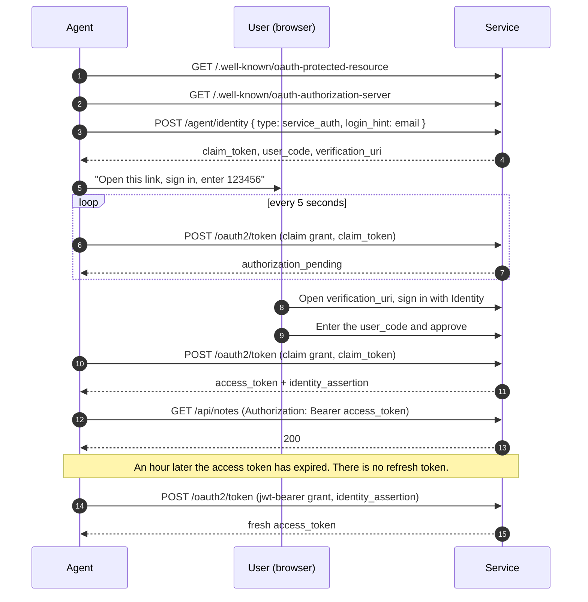

# authmd-dotnet

Let AI agents register and sign in to your ASP.NET Core Identity app on behalf of your users, using the open [auth.md](https://github.com/workos/auth.md) protocol.

Two packages, both targeting .NET 10:

| Package | For | What it does |
| --- | --- | --- |
| `AuthMd.AspNetCore` | Your web app | Makes an ASP.NET Core Identity app an auth.md service: publishes `/auth.md` and the OAuth metadata, accepts agent registrations, issues and validates tokens. Built on [OpenIddict](https://github.com/openiddict/openiddict-core). |
| `AuthMd.Client` | An agent | Discovers a service, registers on a user's behalf, waits for approval, and calls the API with a token it keeps fresh. |

> **Status: `0.1.0-alpha.1`, not yet on NuGet.org.** The packages build and pack from this repository. v1 implements the `service_auth` registration method only; see [Scope](#scope).

## Why auth.md

An agent that wants to act for someone in a web app today has two bad options: drive a browser through the sign-up form and consent screen, or be handed a long-lived API key. auth.md is a third: a small protocol on top of OAuth 2.0 that an agent can follow from a Markdown file at the service's own domain.

The method this project implements, `service_auth`, needs only the user's email:

- The agent asks the service to register it for `user@example.com`.
- The service gives the agent a 6-digit code and a link. **The service never emails the code.** The agent shows it to the user.
- The user opens the link, signs in to the service the way they always do, and types the code into a page the service owns.
- The agent, which has been polling, receives its credentials.

The user approves on the real site, with their real login. The agent never sees a password, and the user can be cut off from the agent without changing one.

## How it works



Two credentials come out of the ceremony:

- An **access token**: a one-hour bearer token for the API.
- An **identity assertion**: a signed JWT standing for the agent's registration, valid 7 days by default. The agent exchanges it for a new access token whenever it needs one. When it expires or the registration is revoked, the agent has to register again, which needs the user.

## Run the demo

You need the .NET 10 SDK.

```bash
# Terminal 1: the sample service, on http://localhost:5125
dotnet run --project samples/AuthMd.Sample.Service

# Terminal 2: the sample agent
dotnet run --project samples/AuthMd.Sample.Agent
```

The agent prints a link and a code. Open the link, sign in as `demo@example.com` with password `Passw0rd!`, and enter the code. The agent then reads the user's notes, adds one, and revokes its access token:

```text
Discovering http://localhost:5125/ ...
  Service:  Sample Notes
  Scopes:   notes.read, notes.write
  Methods:  service_auth

Registering on behalf of demo@example.com ...

  ┌──────────────────────────────────────────────────────────────┐
  │  To let this agent act for you, open the link below, sign    │
  │  in, and enter this code:                                    │
  │                                                              │
  │                         069977                               │
  └──────────────────────────────────────────────────────────────┘
  http://localhost:5125/claim?claim_attempt_token=cat_…

Waiting for approval (expires 11:19 AM) ...
Approved. Registration reg_01a1153244917fe4adc4d9fd70a1dce5.

Reading the user's notes ...
  - Buy oat milk
  - Call the dentist

Adding a note ...
  - Buy oat milk
  - Call the dentist
  - Added by your agent at 11:09 AM

Done. Access token revoked; the registration stays until the user or the service revokes it.
```

To see an agent register for someone who has no account yet, pass a different email:

```bash
dotnet run --project samples/AuthMd.Sample.Agent -- http://localhost:5125/ you@example.com
```

Open the link, choose **Create one** on the sign-in page, sign up with that same email, and you land on the approval page. Only the person signed in with the email the agent named can approve.

The sample keeps everything in memory, so restarting the service wipes its users, registrations and tokens.

## Quickstart: make your app an auth.md service

Until the packages are published, reference the project or pack it locally (`dotnet pack` writes `.nupkg` files you can add as a local source).

### 1. Add the tables to your Identity `DbContext`

```csharp
public class AppDbContext(DbContextOptions<AppDbContext> options)
    : IdentityDbContext<IdentityUser>(options)
{
    protected override void OnModelCreating(ModelBuilder builder)
    {
        base.OnModelCreating(builder);
        builder.AddAuthMd<IdentityUser>();   // claim ceremonies, agent registrations, OpenIddict's tables
    }
}
```

The tables live in your context, so you generate the migration: `dotnet ef migrations add AddAuthMd`.

### 2. Register the services

```csharp
builder.Services
    .AddIdentity<IdentityUser, IdentityRole>()
    .AddEntityFrameworkStores<AppDbContext>();

builder.Services
    .AddAuthMd<IdentityUser>(options =>
    {
        options.ResourceName = "My App";      // shown to the user by the agent
        options.Scopes.Add("notes.read");
        options.Scopes.Add("notes.write");
    })
    .AddEntityFrameworkStores<AppDbContext>();

// The signing and encryption keys are yours to provide. Without them OpenIddict fails with a configuration error.
builder.Services.AddOpenIddict().AddServer(server =>
{
    server.AddSigningCertificate(signingCertificate);
    server.AddEncryptionCertificate(encryptionCertificate);
});
```

For local development you can use `server.AddEphemeralSigningKey().AddEphemeralEncryptionKey()` instead: throwaway keys, so every token dies when the process stops. OpenIddict refuses plain-HTTP requests unless you also call `server.UseAspNetCore().DisableTransportSecurityRequirement()`; do that in development only.

### 3. Map the endpoints and protect your API

```csharp
app.MapAuthMd();

app.MapGet("/api/notes", (ClaimsPrincipal agent) => /* agent.FindFirstValue("sub") is the user's id */)
    .RequireAgentScope("notes.read");
```

`RequireAgentScope` is also available on an `AuthorizationPolicyBuilder`, and `AuthMdAuthorizationExtensions.AuthenticationScheme` names the scheme for `[Authorize(AuthenticationSchemes = …)]`.

### 4. Build the claim page

The package is headless: it ships no UI. You provide one page, at `/claim` by default (`options.ClaimPagePath`), that requires a signed-in user. The agent's link arrives as `/claim?claim_attempt_token=…`.

The page talks to two operations, both of which need the signed-in user's Identity cookie:

| Operation | Request | Response |
| --- | --- | --- |
| Show what is being asked | `GET /agent/identity/claim/view?claim_attempt_token=…` | `{ registration_id, status, login_hint, scopes, expires_at }` where `status` is `pending`, `claimed` or `expired` |
| Approve | `POST /agent/identity/claim/confirm` with JSON `{ "claim_attempt_token": "…", "user_code": "123456" }` | The same shape, with `status: "claimed"` |

Errors come back as `{ "error": "…", "error_description": "…" }`:

| Status | `error` | Meaning |
| --- | --- | --- |
| 401 | `login_required` | Nobody is signed in. |
| 400 | `invalid_claim_token` | The link is not recognized. |
| 403 | `access_denied` | The signed-in user is not the one the agent named. |
| 409 | `claimed_or_in_flight` | Already approved. |
| 410 | `claim_expired` | Too late; the agent must register again. |
| 400 | `invalid_request` | The code is wrong (or the body is malformed). |

[`samples/AuthMd.Sample.Service/Pages/Claim.cshtml`](samples/AuthMd.Sample.Service/Pages/Claim.cshtml) is a working page in about 60 lines of script. Copy it.

### What you get

| Endpoint | Purpose |
| --- | --- |
| `GET /auth.md` | Instructions for agents, generated from your configuration |
| `GET /.well-known/oauth-protected-resource` | RFC 9728 protected resource metadata |
| `GET /.well-known/oauth-authorization-server` | Authorization-server metadata with the `agent_auth` block |
| `POST /agent/identity` | Agent registration (`service_auth`) |
| `GET /agent/identity/claim/view`, `POST /agent/identity/claim/confirm` | The claim page's two operations |
| `POST /oauth2/token` | The claim grant (polling) and the RFC 7523 `jwt-bearer` grant |
| `POST /oauth2/revoke` | RFC 7009 token revocation |

To cut an agent off entirely, revoke its registration from your own code:

```csharp
await agentRegistrationManager.RevokeAsync(registrationId);   // inject AgentRegistrationManager
```

Its identity assertion stops exchanging and every access token it holds stops working.

### Options

| Option | Default | |
| --- | --- | --- |
| `ResourceName`, `ResourceLogoUri` | none | How the service is presented to the user by the agent |
| `Scopes` | empty | The scopes your API understands |
| `Issuer` | derived from each request | Set it when the app sits behind a proxy or answers on several hosts |
| `ClaimPagePath` | `/claim` | Where your claim page lives |
| `ClaimLifetime` | 10 minutes | How long the user has to approve |
| `PollingInterval` | 5 seconds | How often an agent may poll |
| `IdentityAssertionLifetime` | 7 days | How long before an agent must register again |

## Quickstart: write an agent

```csharp
using AuthMd.Client;

using var http = new HttpClient();
var agent = new AuthMdClient(http);

// Give it the service's URL, or the URL of an API that answered 401.
var service = await agent.DiscoverAsync(new Uri("https://app.example.com/"));

var pending = await agent.RegisterAsync(service, "user@example.com");
Console.WriteLine($"Open {pending.VerificationUri}, sign in, and enter {pending.UserCode}");

var session = await pending.WaitForUserAsync();      // polls at the service's pace

var handler = session.CreateHandler();               // attaches and renews the access token
handler.InnerHandler = new HttpClientHandler();
using var api = new HttpClient(handler) { BaseAddress = service.Resource };

var notes = await api.GetStringAsync("api/notes");

await session.RevokeAccessTokenAsync();              // optional: clean up when the task is done
```

Three exceptions tell you what went wrong:

- `AuthMdDiscoveryException`: the service's documents could not be read. It may not be an auth.md service.
- `RegistrationRequiredException`: the user did not approve in time, or the identity assertion expired or was revoked. Start again from `RegisterAsync`.
- `AuthMdProtocolException`: the service refused for any other reason; `Error` carries its code. (`RegistrationRequiredException` derives from it.)

## Scope

auth.md defines three registration methods. v1 implements one.

| Method | When an agent uses it | Here |
| --- | --- | --- |
| `service_auth` | It has only the user's email. The user approves on the service's page. | **Implemented** |
| `identity_assertion` | It holds an identity token from a provider the service trusts. | Not yet. Refused with `issuer_not_enabled`. |
| `anonymous` | It has no user yet; a human can take ownership later. | Not yet. Refused with `anonymous_not_enabled`. |

Known limits of this version:

- **String user keys only.** The tables are foreign-keyed to `IdentityUser<string>`; apps whose users have `Guid` or `int` keys are not supported yet.
- **One approval window.** Upstream auth.md lets an agent ask for a fresh code within a 24-hour window. Here the code and the window both last `ClaimLifetime`; after that the agent registers again.
- **No listing of a user's agents.** You can revoke a registration by id, but the package does not yet offer "all registrations for this user", so a "my agents" page needs your own query.
- **Agents are not named.** The `service_auth` request carries no agent identity, so the claim page can show the scopes and the account, not which agent is asking.
- **A store read per API call.** Registration revocation is enforced by looking the registration up on each protected request.
- **Client:** the 401-and-retry renewal only repeats requests without a body; discovery does not yet cross-check the issuer and resource values the documents report; a session cannot be restored from a saved identity assertion in a new process.
- **No provider-driven events endpoint** (security event token delivery).

## Develop

```bash
dotnet build
dotnet test
dotnet pack --configuration Release --output artifacts
```

The tests drive both packages over HTTP through `WebApplicationFactory`, against an Identity test host on in-memory SQLite. The headline test, `Agent_registers_on_behalf_of_a_user_and_calls_the_protected_api`, runs the whole ceremony with `AuthMd.Client` on one side and `AuthMd.AspNetCore` on the other.

Vocabulary is fixed in [CONTEXT.md](CONTEXT.md).

## License

[MIT](LICENSE)
